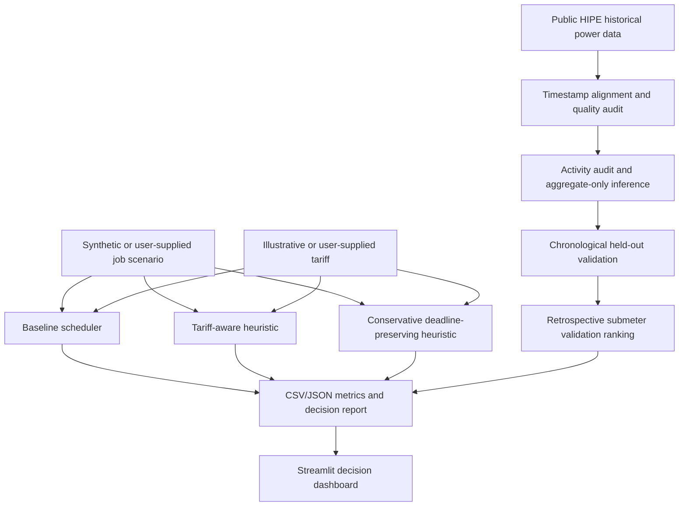

# ForgeFlex architecture

Historical data diagnostics, model evaluation, retrospective sensor ranking, and scheduling simulations are separate evidence streams. The current system consolidates them for review but does not feed sensor scores into the scheduler as a coupled optimization objective.
